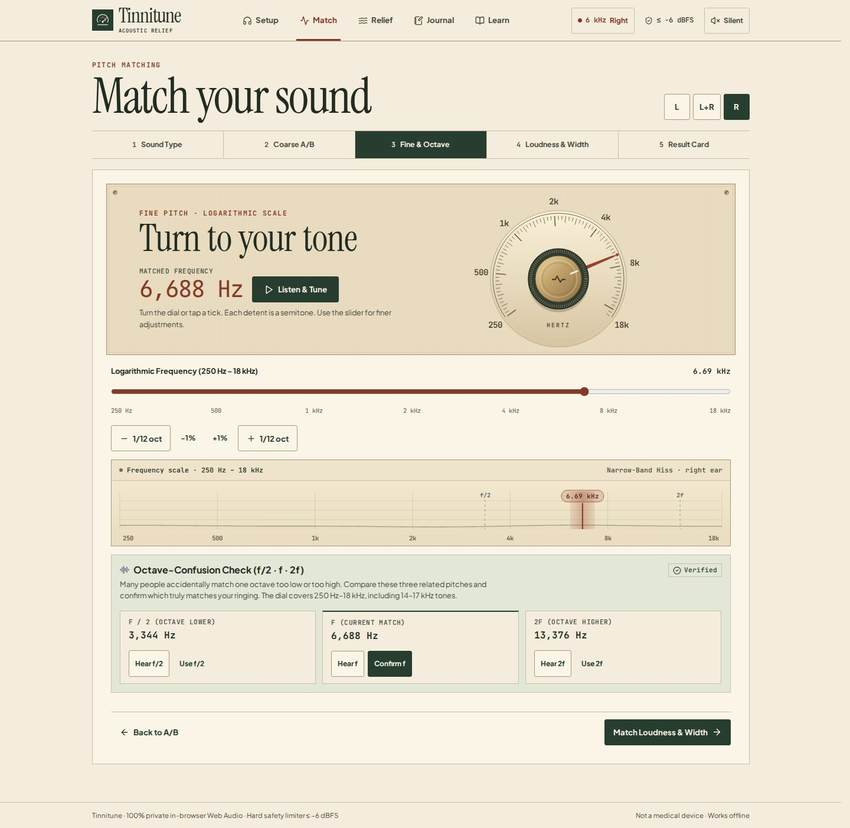
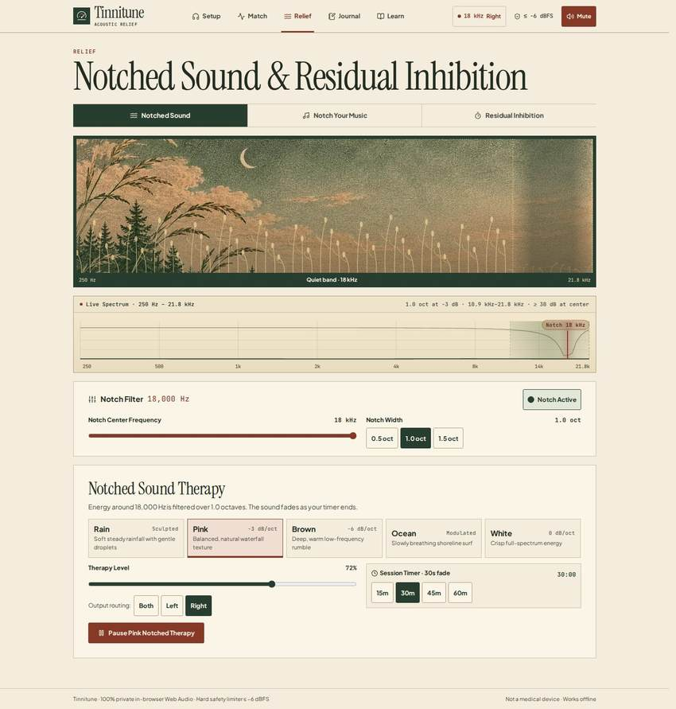
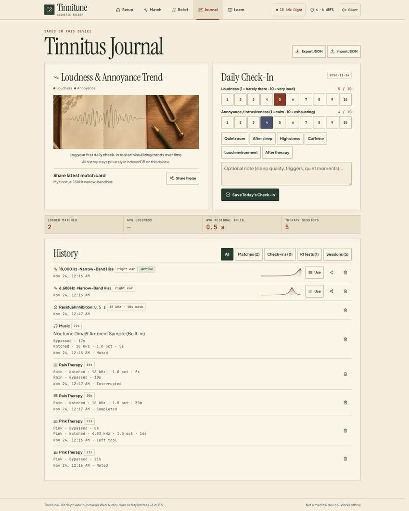
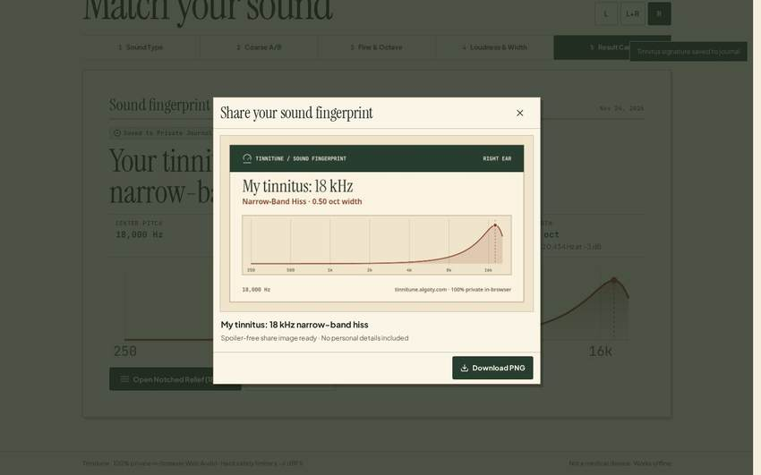

# Tinnitune

A private, in-browser tool for matching your tinnitus pitch and trying notched sound therapy. Tinnitus can be hard to describe. Tinnitune lets you compare sounds until one resembles what you hear, then use that estimate to filter a sound bed around your matched pitch. Your listening history, journal entries, and music files stay on your device.

[Open Tinnitune](https://tinnitune.algoty.com/)

## The Listening Instrument

Turn the engraved tuning dial or tap a scale mark to move through the pitch range in semitone detents. The needle follows a logarithmic scale, so each octave takes up the same amount of space. Use the arrow keys to tune by semitone or the slider to make finer adjustments.

| The tuning dial and octave check | The Relief garden and its quiet band |
| --- | --- |
|  |  |

| Private Journal | Sound fingerprint share card |
| --- | --- |
|  |  |

## Features

- **Guided match.** Pick a sound texture and ear, compare pitches in an A/B test, and refine the pitch, loudness, and bandwidth.
- **Octave check.** Compare the current pitch with one octave below and one octave above when those frequencies are in range.
- **Notched sound therapy.** Set a notch width and timer for rain, ocean, pink noise, brown noise, or white noise. You can also apply the notch to a local music file. The garden shows where the filter reduces energy.
- **Residual inhibition test.** Listen to a timed masking sound and record whether your tinnitus briefly quiets and how long the change lasts.
- **Journal and export.** Track daily loudness and annoyance, matches, listening sessions, and test results. Export or restore a JSON backup, or download a PNG of a single match.

## Audio safety

All playback passes through a hard digital limiter. Final browser QA measured a maximum sample peak of **−15.19 dBFS** across the five sound beds at maximum in-app comfort and therapy levels, with the notch active and bypassed. That is about 9.2 dB below the **−6 dBFS** cap. dBFS measures the digital signal. The volume at your ears also depends on your device and headphones, so start at a low, comfortable level.

## Medical disclaimer and evidence

**Tinnitune is not a medical device.** Use it to explore pitch matching and sound enrichment. Seek urgent medical care for sudden hearing loss, acute vertigo, or sudden facial weakness. Consult a clinician for persistent one-sided tinnitus or tinnitus that pulses with your heartbeat. [NICE guidance on tinnitus referrals](https://www.nice.org.uk/guidance/ng155/chapter/Recommendations#referring-people-with-tinnitus)

The Learn section covers the mixed evidence for notched music and links to these sources.

- Tinnitus overview. [NIDCD tinnitus fact sheet](https://www.nidcd.nih.gov/health/tinnitus), [Baguley et al. (2013), *Tinnitus*, The Lancet](https://pubmed.ncbi.nlm.nih.gov/23827090/), [Heriot-Watt record for the Baguley article](https://researchportal.hw.ac.uk/en/publications/tinnitus/).
- Notched music and broader sound therapy. [Okamoto et al. (2010)](https://pmc.ncbi.nlm.nih.gov/articles/PMC2824261/), [Stein et al. (2016)](https://pubmed.ncbi.nlm.nih.gov/26987755/), [Cochrane review of sound therapy devices](https://www.cochrane.org/evidence/CD013094_sound-therapy-using-amplification-devices-andor-sound-generators-tinnitus).
- Pitch matching and octave confusion. [Moore et al. (2010)](https://pubmed.ncbi.nlm.nih.gov/20103482/), [Henry et al., VA pitch-matching study](https://ohsu.elsevierpure.com/en/publications/comparison-of-two-computer-automated-procedures-for-tinnitus-pitc/).
- Residual inhibition and clinical care. [Roberts et al. (2008)](https://pmc.ncbi.nlm.nih.gov/articles/PMC2580805/), [AAO-HNS tinnitus guideline (2014)](https://pubmed.ncbi.nlm.nih.gov/25273878/), [American Tinnitus Association guide to finding care](https://www.ata.org/about-tinnitus/why-are-my-ears-ringing/who-should-i-see-for-help/).

## Architecture

- **Interface.** Vite builds the React and TypeScript app.
- **Web Audio.** Cascaded biquad notch filters shape sound beds and music. Band-pass filters shape matching sounds and the residual inhibition masker. The master output runs through a compressor and a hard waveshaper limiter. Fades and masker cutoff are scheduled on the audio clock.
- **Local storage.** IndexedDB holds Journal records, and browser storage keeps preferences and drafts. The browser decodes local music files directly.
- **Offline PWA.** After an initial online load, the production service worker caches the app, fonts, and artwork so matching, playback, and journaling work offline.

## Run locally

Use Node.js 22.18 or newer and npm.

```sh
npm ci --include=dev
npm run dev
```

Open [http://127.0.0.1:6805/](http://127.0.0.1:6805/). To try the production build and offline behavior, stop the development server and run the following commands.

```sh
npm run build
npm run preview
```

## Tests

Stop any development or preview server before running the browser suites. The commands start and stop their own local preview. E2E checks of external Learn links require an internet connection.

```sh
npx playwright install chromium webkit
npm run build
npm run test:journal
npm run test:dsp
npm run test:e2e
```

- **Journal.** Five tests cover backup round-trips, older records, invalid input, and device calibration.
- **Web Audio.** Production QA passed 468 notch-width checks, 165 matching and masking bandwidth checks, 344 stereo safety renders, 36 notch-switch cases, and 60 noise-loop seam cases.
- **Browser and offline.** Production QA passed desktop and mobile Chromium, iPhone-sized WebKit emulation, and offline reload. Final live verification exercised Setup through match, notched playback, residual inhibition, Journal persistence, and share-card download. It found zero blockers and zero major issues.

## Known issues

- Automated browsers may get a reCAPTCHA or HTTP 403 from PubMed when opening the Baguley paper. The same citation is available through the university’s research portal. [Heriot-Watt record](https://researchportal.hw.ac.uk/en/publications/tinnitus/)
- The earlier Wiley verification page was resolved by linking directly to the Cochrane evidence summary. The direct link opened in both verification browsers.

## License

[MIT](LICENSE) © 2026 Milad Rashidikhah.
